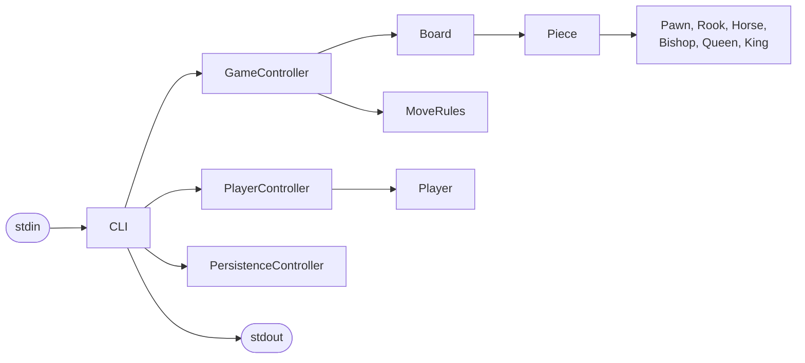

# Project Report: Chess Variant

| | |
|---|---|
| Degree | Computer Engineering (Licenciatura em Engenharia Informática), [IADE](https://www.iade.europeia.pt/) |
| Year | 2024/2025, 1st year, 1st semester |
| Courses | Fundamentos da Programação (Fundamentals of Programming) and Estruturação do Pensamento Lógico (Structuring of Logical Thinking) |
| Teaching method | Project-based learning (PBL) |
| Language | C# on .NET 8, standard library only |

## Contents

1. [Team](#1-team)
2. [Solution architecture](#2-solution-architecture)
3. [Data structures](#3-data-structures)
4. [Algorithms](#4-algorithms)
5. [Special operations](#5-special-operations)
6. [Saving and loading](#6-saving-and-loading)
7. [Implemented features](#7-implemented-features)
8. [Decisions on open points](#8-decisions-on-open-points)
9. [Testing](#9-testing)
10. [How to run](#10-how-to-run)

## 1. Team

| Student | Number |
|---|---|
| Tiago Manuel Antunes Cabaça | 20241185 |

The project is done individually, so every part of it (design, implementation, tests and
documentation) is my own work.

## 2. Solution architecture

The solution is organised in three layers: models, controllers and a view. The models hold
the state and the rules of chess, the controllers carry out the instructions and return the
messages to show, and the view is the only part that reads from and writes to the console.



### 2.1 Models

| Class | Responsibility |
|---|---|
| `Position` | Converts a square such as `E4` into a row and a column, and back |
| `Piece` | Colour, type, index, symbol (`WP3`), position, whether it has moved and whether its special operation was used |
| `Pawn`, `Rook`, `Horse`, `Bishop`, `Queen`, `King` | The normal movement of each piece and its special operation |
| `Board` | The 8 x 8 grid, the initial layout, the reading of a board in text form and the rendering for `DJ` |
| `MoveRules` | Whether a square is attacked by a colour, and whether a colour is in check |
| `Player` | Name and results: wins, draws and losses |

### 2.2 Controllers

| Class | Responsibility |
|---|---|
| `PlayerController` | The registered players: `RJ` and `LJ` |
| `GameController` | The game in progress: `IJ`, `MP`, `OS`, `DJ` and `D`, turns, check, checkmate and the end of the game |
| `PersistenceController` | `G` and `L`: writing and reading the save file |

### 2.3 View and entry point

`Views/CLI.cs` reads one instruction per line, checks the number of arguments, calls the
right controller and prints its answer. For `IJ Continuação` it also reads the eight board
lines that follow. `Program.cs` sets the console to UTF-8 and starts the CLI. The program
ends on an empty line or at the end of the input.

### 2.4 Folder layout

```text
src/Project
├── Program.cs
├── Views/CLI.cs
├── Controllers/  GameController.cs, PlayerController.cs, PersistenceController.cs
└── Models/       Board.cs, MoveRules.cs, Piece.cs, Player.cs, Position.cs
    └── Pieces/   Pawn.cs, Rook.cs, Horse.cs, Bishop.cs, Queen.cs, King.cs
```

## 3. Data structures

| Structure | Where | Why |
|---|---|---|
| `Piece?[][]` | The board | Direct access to any square by row and column; an empty square is `null` |
| Class hierarchy `Piece` and six subclasses | The pieces | Each piece type overrides its own movement and special operation, so the game code treats every piece the same way |
| `List<Player>` | Registered players | Few elements; searched by name and sorted for `LJ` |
| `List<(int, int)>` | Candidate moves of a piece | A short list of target squares produced by each piece |
| `Position` (row and column) | Squares | One small type for every square instead of pairs of loose integers |

The game holds references to the registered `Player` objects, never copies, so the result of
a game is recorded directly in the statistics shown by `LJ`.

## 4. Algorithms

### 4.1 Movement of the pieces

Each piece produces the squares it can reach under its own rules. Rooks, bishops and queens
slide square by square in their directions and stop at the first occupied square, which they
may capture if it holds an opposing piece. The horse jumps in an L, the king steps one square
in any direction, and the pawn moves forward one square (two from its starting row) and
captures diagonally.

### 4.2 Legal moves and check

A move that is possible for the piece is only legal if it does not leave the player's own
king in check. To test it, the game plays the move on the board, asks `MoveRules` whether the
king is attacked, and undoes the move. A square is attacked when any opposing piece could
capture on it; pawns attack only diagonally.

### 4.3 Checkmate and stalemate

After every move the game looks at the opponent:

- in check and without any legal move: checkmate, the game ends and the mover wins;
- in check with a legal move: the answer is `Check.`;
- not in check and without any legal move: stalemate, the game ends in a draw.

Finding a legal move means trying the moves of every piece of that colour until one passes
the test in 4.2.

### 4.4 Special moves of chess

| Move | Rule |
|---|---|
| Castling | The king moves two squares towards a rook; neither has moved, the squares between them are empty, and the king is not in check and does not cross or land on an attacked square |
| En passant | Right after a pawn moves two squares, an opposing pawn beside it may capture it as if it had moved one square; the chance lasts one turn |
| Promotion | A pawn that reaches the last row becomes a queen with the next free index of its colour |

### 4.5 Output of a move

A move prints one line, the first that applies: checkmate, check, capture, promotion,
castling, en passant, or the normal move message.

## 5. Special operations

Every piece except the king has a special operation, used with `OS`.

| Piece | Operation | Limit |
|---|---|---|
| Pawn | One square backwards, onto an empty square | Once per pawn |
| Rook | Captures two opposing pieces in a straight line: the first one is next to the rook, the second is the next piece after it, and the rook lands on the second | Once per rook |
| Horse | When no piece touches it, jumps exactly four squares in a straight line (orthogonal or diagonal) over anything, and may capture on landing | No limit |
| Bishop | Captures every opposing pawn in the 3 x 3 square around it, without moving | Once per bishop |
| Queen | Swaps places with its king, if the king is not in check before or after the swap | No limit |

The geometry of each operation lives in its piece class. The game controller checks the
errors in the order set by the assignment, rejects an operation that would leave the
player's own king in check, and then reports a check or a checkmate it causes on a second
line.

## 6. Saving and loading

`G` writes a plain text file with every registered player and, when there is one, the game in
progress: the players, whose turn it is, every piece with its square and movement state, and
the en passant chance. `L` reads the file and replaces everything. The format is described at
the top of `PersistenceController.cs`.

## 7. Implemented features

Every instruction in the assignment is implemented: `RJ`, `LJ`, `IJ` (new and continued
games), `MP`, `OS`, `DJ`, `D`, `G` and `L`, with all the success and error messages and the
error order defined for each one. The rules include check, checkmate, stalemate, castling, en
passant, promotion and the five special operations. An unknown instruction, or a wrong number
of arguments, prints `Instrução inválida.`

## 8. Decisions on open points

The assignment does not define every situation. These are the choices made:

| Situation | Behaviour |
|---|---|
| Which player is White in `IJ` | The first name plays White, the second Black |
| Who starts a continued game | White, and every piece counts as not yet moved |
| Unknown text in a board cell of `IJ Continuação` | Treated as an empty square |
| What `DJ` prints after the board | `Vez de Name.` with the player to move |
| A move that is both a capture and something else | One line, by the priority in 4.5 |
| An en passant capture | `En passant efetuado.` |
| Castling while in check or through an attacked square | Not allowed, as in normal chess |
| Stalemate | The game ends in a draw |
| A special operation that would capture a king | Not allowed |
| The bishop operation with no pawn to capture | `Movimento inválido.`, and the operation is not used up |
| Ties in `LJ` | Sorted by name with the invariant culture, the same on every computer |
| `G` or `L` with a file that cannot be written or read | `Erro ao gravar o ficheiro.` or `Erro ao ler o ficheiro.` |

## 9. Testing

The program is checked with input/output tests in `iotests/`. Each `NN-name.in` file is fed to
the program and the output must match `NN-name.out` byte by byte. The scripts
`run-tests.sh` and `run-tests.ps1` build the project and run every test, and GitHub Actions
runs them on every push.

| Test | Covers |
|---|---|
| `01-players` | Registering and listing players |
| `02-new-game-and-board` | Starting a game and the board printed by `DJ` |
| `03-moves-and-captures` | Normal moves and captures |
| `04-check-and-checkmate` | Check, illegal moves into check and checkmate |
| `05-castling-en-passant-promotion` | The special moves of chess |
| `06-continued-game` | Starting from a given board |
| `07-special-operations` | The five special operations and their limits |
| `08-resign-and-stats` | Resignation, draws and the statistics in `LJ` |
| `09-save-and-load` | Saving a game, loading it and playing on |
| `10-errors` | The error messages of every instruction |

## 10. How to run

With the .NET 8 SDK installed, from the root of the repository:

```bash
dotnet run --project src/Project
```

Type one instruction per line and an empty line to finish. To run the tests:

```bash
./run-tests.sh
```
